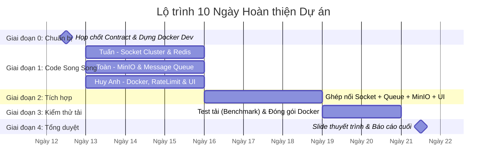

# KẾ HOẠCH PHÂN CHIA CÔNG VIỆC 10 NGÀY HOÀN THIỆN DỰ ÁN
## ĐỀ TÀI: NÂNG CẤP HỆ THỐNG REAL-TIME MESSENGER (CLOUD DESIGN PATTERNS)
**(Dành cho Nhóm 3 thành viên - Môi trường Bài tập lớn / Đồ án Đại học)**

---

## 1. NGUYÊN TẮC TỔ CHỨC LÀM VIỆC SONG SONG (PARALLEL WORK)

Để 3 Huy Anhó thể **làm việc đồng thời mà không phải chờ đợi nhau**, nhóm áp dụng nguyên tắc **Contract-First (Thống nhất giao ước trước khi viết code)**:
1. **Ngày 1 chốt giao ước (API & Event Contract):** Cả nhóm thống nhất tên Socket Event, cấu trúc JSON Request/Response, tên Redis Key trước. Mỗi Huy Anhó thể tự mock (giả lập) dữ liệu của người khác để lập trình độc lập.
2. **Dùng chung hạ tầng Docker ngay từ đầu:** Thành viên phụ trách DevOps tạo sẵn file `docker-compose.yml` (chứa Redis, MinIO, MariaDB) vào ngày đầu tiên để 2 Huy Anhòn lại chỉ cần `docker compose up` là có đầy đủ môi trường dev cục bộ chuẩn hóa.
3. **Phân rã module theo chiều dọc (Vertical Slicing):** Mỗi thành viên làm chủ trọn vẹn các Pattern độc lập, hạn chế tối đa việc sửa chung một tệp tin (tránh Git conflict).

---

## 2. PHÂN VAI TRÁCH NHIỆM (ROLE & RESPONSIBILITY)

| Thành viên | Vai trò chính | Trọng tâm phụ trách | Pattern phụ trách chính |
| :--- | :--- | :--- | :--- |
| **Tuấn** *(Trưởng nhóm / Backend Real-time)* | Real-time & Data Architecture | • Tối ưu Database & Indexing • Cụm Socket.IO đa máy chủ • Quản lý Presence phân tán | **Pattern 1:** Pub/Sub & Cache-Aside |
| **Toàn** *(Backend Worker & Media)* | Storage & Asynchronous Worker | • Dịch vụ lưu trữ MinIO S3 • Hàng đợi BullMQ / Redis Queue • Background Worker ghi DB | **Pattern 2:** Valet Key **Pattern 3:** Queue-Based Load Leveling |
| **Huy Anh** *(DevOps, Security & Web/QA)* | DevOps, Security & Frontend | • Môi trường Docker Compose • Bảo mật, Rate Limit & Circuit Breaker • Giao diện Web Client & Benchmark tải | **Pattern 4:** Rate Limiting & Circuit Breaker |

---

## 3. LỘ TRÌNH 10 NGÀY CHI TIẾT & DEADLINE TỪNG THÀNH VIÊN

---

### GIAI ĐOẠN 0: KHỞI ĐỘNG & THỐNG NHẤT GIAO ƯỚC (NGÀY 1)
> **Mục tiêu:** Mọi người có chung môi trường dev, có tài liệu Contract rõ ràng để bắt đầu code song song.

* **Cả nhóm (2 giờ đầu):**
  * Thống nhất danh sách Socket Event: `send_message`, `receive_message`, `user_status_changed`, `message_delivered`.
  * Thống nhất DTO tin nhắn gửi qua Queue: `{ messageId, chatBoxId, senderId, content, mediaUrl, createdAt }`.
  * Thống nhất quy ước Redis Key: `online_users:{userId}`, `rate_limit:{userId}`.
* **Tuấn:**
  * Tạo nhánh Git `feature/phase1-socket-redis`.
  * Cập nhật `prisma/schema.prisma`: Thêm composite index `@@index([chatBoxId, createdAt])` và cột `mediaUrl` cho bảng `Message`.
  * Chạy `npx prisma migrate dev` và commit schema chung cho cả nhóm.
* **Toàn:**
  * Tạo nhánh Git `feature/phase1-media-queue`.
  * Nghiên cứu thư viện `@aws-sdk/client-s3` và `bullmq`.
  * Viết mockup service tạo Pre-signed URL trả về link giả lập cho Huy Anh test giao diện trước.
* **Huy Anh:**
  * Tạo nhánh Git `feature/phase1-docker-security`.
  * Viết file `docker-compose.dev.yml` chứa: **MariaDB 10.6**, **Redis 7.2-alpine**, **MinIO (S3 clone)**.
  * Hướng dẫn 2 bạn chạy lệnh `docker compose -f docker-compose.dev.yml up -d` để có sẵn DB, Redis, MinIO trên localhost.
* ⏰ **Hạn chót Ngày 1 (22:00):** Cả 3 người đều chạy được Docker cục bộ và pull code nhánh main đã có Prisma Schema mới.

---

### GIAI ĐOẠN 1: TRIỂN KHAI ĐỘC LẬP THEO CHIỀU DỌC (NGÀY 2 - NGÀY 4)
> **Mục tiêu:** Mỗi người hoàn thành 100% module của mình và có Unit Test độc lập.

#### 👤 Tuấn (Backend Real-time & Redis):
* **Ngày 2:** Cài đặt `@socket.io/redis-adapter` và `ioredis`. Cấu hình Socket.IO server gắn Redis Pub/Sub Adapter. Viết Unit Test kiểm tra khởi tạo kết nối.
* **Ngày 3:** Xây dựng `PresenceService.js` dùng Redis Hashes/Sets (`HSET`, `HDEL`, `EXPIRE`) để lưu vết trạng thái online của `userId`. Xử lý bài toán 1 user mở nhiều tab trình duyệt (`socket.id`).
* **Ngày 4:** Cập nhật `MessageRepository.js` hỗ trợ Cursor-based Pagination (phân trang theo con trỏ dựa trên index mới tạo) thay vì Offset `skip/take` để tối ưu truy vấn chat lịch sử.
* 🎯 **Sản phẩm bàn giao:** Module Socket.IO chạy độc lập trên Redis; test Jest xanh 100%.

#### 👤 Toàn (Storage MinIO & Message Queue):
* **Ngày 2:** Xây dựng `StorageService.js` kết nối MinIO cục bộ (tạo bucket `messenger-media` nếu chưa có). Viết hàm `generatePresignedUploadUrl(fileName, mimeType)`.
* **Ngày 3:** Tạo API REST `/api/media/presigned-url` (yêu cầu JWT) để cấp link upload có hạn 5 phút. Viết bộ lọc chặn các file nguy hiểm (`.exe`, `.sh`, `.bat`).
* **Ngày 4:** Cài đặt `bullmq`. Tạo queue `chat-message-queue`. Viết tiến trình nền `MessageWorker.js` chuyên rút tin nhắn từ queue và gọi `MessageRepository.create()` lưu vào MariaDB.
* 🎯 **Sản phẩm bàn giao:** API lấy Pre-signed URL hoạt động được; Worker chạy ngầm bốc tin nhắn từ Queue ghi vào DB độc lập.

#### 👤 Huy Anh (DevOps, Security & Frontend):
* **Ngày 2:** Cài đặt `express-rate-limit` cho REST API (chống brute-force login). Viết custom Socket Middleware Rate Limiter (tối đa 5 tin nhắn/giây cho mỗi socket kết nối).
* **Ngày 3:** Tích hợp Circuit Breaker (dùng thư viện `opossum`) bọc quanh module gọi dịch vụ bên ngoài (giả lập một dịch vụ gửi thông báo Notification giả định).
* **Ngày 4:** Nâng cấp Web Client (`public/js/app.js` và `public/index.html`):
  * Thêm nút bấm đính kèm ảnh/file cạnh ô chat.
  * Viết code Javascript cho client: bấm chọn file ➔ gọi API lấy Pre-signed URL ➔ dùng `fetch(PUT)` đẩy file thẳng lên MinIO ➔ nhận link ảnh gửi vào socket.
* 🎯 **Sản phẩm bàn giao:** Bộ lọc Rate Limiter + Giao diện Web đã có nút gửi ảnh và preview ảnh trong khung chat.

---

### GIAI ĐOẠN 2: TÍCH HỢP HỆ THỐNG & GHÉP NỐI (NGÀY 5 - NGÀY 7)
> **Mục tiêu:** Nối các module độc lập lại với nhau thành luồng nghiệp vụ hoàn chỉnh.

* **Ngày 5: Ghép luồng Tin nhắn qua Queue (Tuấn + Toàn)**
  * Khi client bắn socket `send_message`, `socketHandler.js` của Tuấn phát ngay tới người nhận bằng Redis Pub/Sub, đồng thời đẩy một Job vào `chat-message-queue` của Toàn.
  * Worker của Toàn ghi DB xong thì phát event xác nhận `message_persisted`.
* **Ngày 6: Ghép luồng Gửi Media từ Web Client lên MinIO (Toàn + Huy Anh)**
  * Huy Anh nối UI web thật với API Pre-signed URL của Toàn.
  * Thử nghiệm gửi ảnh dung lượng 5MB - 10MB: Xác nhận ảnh nhảy thẳng vào MinIO, không qua server Node.js. Người nhận hiển thị ảnh tức thì.
* **Ngày 7: Gắn Rate Limiter & Circuit Breaker vào Socket Server (Tuấn + Huy Anh)**
  * Gắn Socket Rate Limiter vào sự kiện `send_message`.
  * Viết xử lý hiển thị lỗi phía Client: nếu người dùng gõ phím spam quá nhanh, màn hình hiển thị cảnh báo *"Bạn đang gửi tin nhắn quá nhanh, vui lòng chờ 1 giây"*.
* ⏰ **Hạn chót Ngày 7 (23:00):** Toàn bộ tính năng hoàn chỉnh, chạy trơn tru end-to-end trên máy của cả 3 người.

---

### GIAI ĐOẠN 3: ĐÓNG GÓI DOCKER & KIỂM THỬ TẢI CHỨNG MINH (NGÀY 8 - NGÀY 9)
> **Mục tiêu:** Chuẩn bị số liệu thực nghiệm và kịch bản demo "1 câu lệnh là chạy".

* **Tuấn (Benchmark & Kiểm thử hiệu năng):**
  * Dùng công cụ `artillery` hoặc `autocannon` tạo kịch bản bắn 2.000 tin nhắn trong 10 giây.
  * Đo lường 2 trường hợp:
    1. Khi chưa có Queue (kiến trúc cũ): MariaDB nghẽn connection, lỗi timeout xuất hiện.
    2. Khi có Queue (kiến trúc mới): Hệ thống hấp thụ 100% tin nhắn, độ trễ phát socket <25ms, MariaDB CPU ổn định.
  * Chụp ảnh biểu đồ và lưu bảng số liệu làm dẫn chứng cho báo cáo.
* **Toàn (Đóng gói Production Docker Compose):**
  * Hoàn thiện file `docker-compose.yml` tổng thể gồm:
    * `app-instance-1` (Node.js Port 3001)
    * `app-instance-2` (Node.js Port 3002)
    * `worker` (Tiến trình bốc queue riêng)
    * `redis`
    * `minio`
    * `mariadb`
    * `nginx` (Load Balancer chia tải vào Port 3001 và 3002)
  * Đảm bảo bất kỳ ai clone project về chỉ cần gõ: `docker compose up --build` là chạy trọn vẹn cả cụm!
* **Huy Anh (Kiểm thử chức năng chéo & Xử lý lỗi vặt):**
  * Đóng vai trò QA: Tạo 2 tài khoản, mở 4 tab ẩn danh khác nhau, kiểm tra chat qua lại khi ngắt/bật mạng.
  * Kiểm tra tính đúng đắn khi 1 container app bị tắt đột ngột (Failover test).
  * Chuẩn bị sẵn bộ tài khoản test và dữ liệu mẫu (Seeding data).
* ⏰ **Hạn chót Ngày 9 (22:00):** Code freeze (Đóng băng code). Không sửa code logic nữa, chỉ tập trung làm tài liệu và thuyết trình.

---

### GIAI ĐOẠN 4: TỔNG DUYỆT, HOÀN THIỆN BÁO CÁO & SLIDE (NGÀY 10)
> **Mục tiêu:** Sẵn sàng bảo vệ đạt điểm tối đa trước Hội đồng Đánh giá.

* **Tuấn (Slide Thuyết trình):**
  * Làm 10-12 slide ngắn gọn:
    * Slide 1-3: Vấn đề hệ thống cũ (Nghẽn RAM, nghẽn DB, nghẽn mạng).
    * Slide 4-7: 4 Cloud Design Patterns áp dụng (Hình vẽ trực quan).
    * Slide 8-9: Số liệu đo lường thực tế (Biểu đồ so sánh trước/sau khi cải tiến).
    * Slide 10: Kết luận và hướng phát triển.
* **Toàn (Video Demo Dự phòng):**
  * Quay một video ngắn (2-3 phút) quay màn hình: Mở 2 cửa sổ chat real-time, gửi ảnh, demo tắt bớt 1 server mà chat vẫn chạy bình thường nhờ Redis Adapter.
  * *(Video này cực kỳ quan trọng để phòng trường hợp máy chiếu hoặc mạng của phòng học bị lỗi lúc báo cáo).*
* **Huy Anh (Tài liệu Báo cáo & Hướng dẫn Cài đặt):**
  * Hoàn thiện tài liệu Word/PDF dựa trên `BAO_CAO_CAI_TIEN_KIEN_TRUC.md`.
  * Cập nhật file `README.md` ở thư mục gốc: Ghi rõ cách chạy nhanh bằng Docker, danh sách cổng dịch vụ, tài khoản test mặc định.
* **Cả nhóm (20:00 - 22:00):**
  * Họp tổng duyệt online/offline: Tập thuyết trình thử một lượt, phân chia người nói từng phần, đặt câu hỏi phản biện giả lập để cùng tập trả lời.

---

## 4. BẢNG CHECKLIST NGHIỆM THU THEO TỪNG THÀNH VIÊN

Dùng bảng này để kiểm tra chéo (Peer Review) trước khi nộp bài:

| Thành viên | Hạng mục cam kết hoàn thành | Trạng thái |
| :--- | :--- | :---: |
| **Tuấn** | [ ] Chạy được 2 server Socket.IO nhận diện nhau qua Redis Pub/Sub Adapter | ⬜ |
| | [ ] Mở nhiều tab trên 1 user, đóng 1 tab vẫn online, đóng hết mới offline | ⬜ |
| | [ ] Database có composite index `(chatBoxId, createdAt)`, pagination chạy mượt | ⬜ |
| | [ ] Có biểu đồ benchmark so sánh hiệu năng tải (Artillery/Autocannon) | ⬜ |
| **Toàn** | [ ] MinIO chạy tốt trên Docker, tự tạo bucket `messenger-media` khi khởi động | ⬜ |
| | [ ] API trả về Pre-signed URL hợp lệ, upload trực tiếp file lên MinIO thành công | ⬜ |
| | [ ] Queue BullMQ nhận job tin nhắn, Worker lưu MariaDB thành công không mất tin | ⬜ |
| | [ ] Đóng gói hoàn chỉnh file `docker-compose.yml` chạy đa container | ⬜ |
| **Huy Anh** | [ ] Docker Dev (`docker-compose.dev.yml`) bàn giao đúng hạn ngày 1 | ⬜ |
| | [ ] Spam tin nhắn bị chặn bởi Rate Limiter kèm thông báo lỗi rõ ràng | ⬜ |
| | [ ] Giao diện Web có nút gửi ảnh, hiển thị ảnh chat đẹp mắt | ⬜ |
| | [ ] Slide thuyết trình và Video demo dự phòng sẵn sàng | ⬜ |
