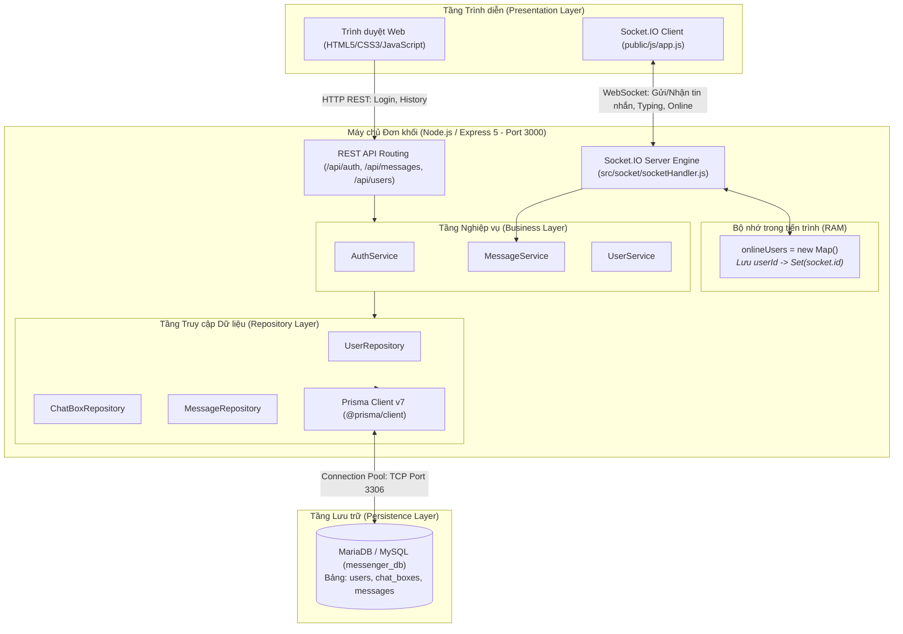
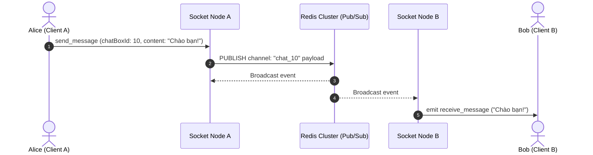
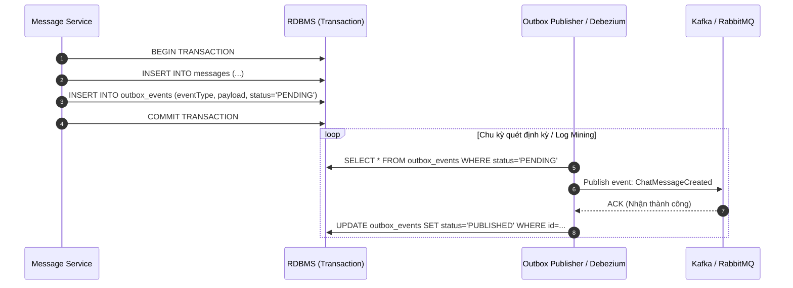
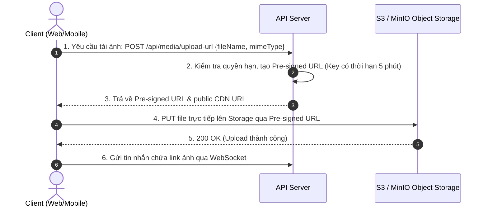
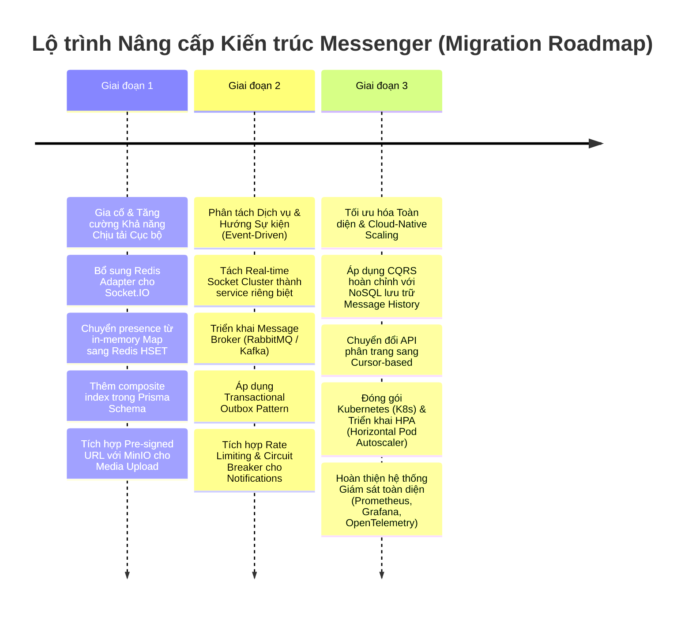
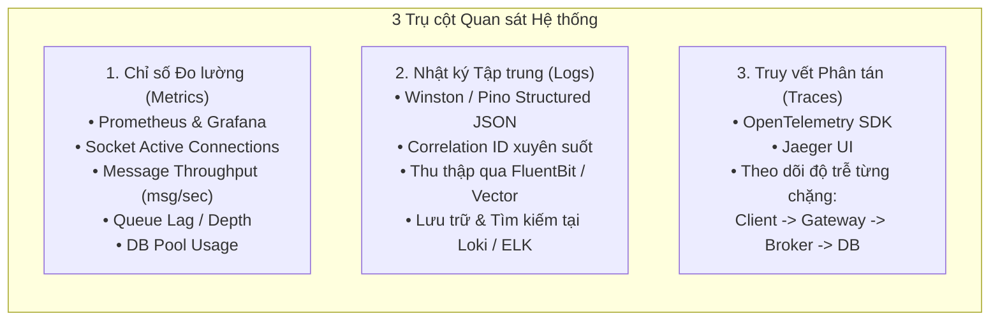

# 📐 Báo cáo Đánh giá Kiến trúc Hiện tại & Tài liệu Ý tưởng Cải tiến Kiến trúc Ứng dụng Real-Time Messenger với Cloud Design Patterns

> **Dự án:** Real-Time Messenger Application  
> **Ngôn ngữ & Nền tảng:** Node.js, Express, Socket.IO, Prisma ORM, MariaDB/MySQL  
> **Định hướng kiến trúc:** Hybrid Event-Driven Cloud-Agnostic Architecture  
> **Ngày lập:** 10/11/2026  
> **Trạng thái:** Bản đề xuất hoàn chỉnh (Architectural Specification)

---

## MỤC LỤC
1. [TỔNG QUAN VÀ MỤC TIÊU DỰ ÁN](#1-tổng-quan-và-mục-tiêu-dự-án)
2. [ĐÁNH GIÁ CHI TIẾT KIẾN TRÚC HIỆN TẠI (AS-IS EVALUATION)](#2-đánh-giá-chi-tiết-kiến-trúc-hiện-tại-as-is-evaluation)
   - 2.1. Kiến trúc tổng thể và luồng dữ liệu
   - 2.2. Chi tiết triển khai mã nguồn
   - 2.3. Ma trận phân tích điểm nghẽn & rủi ro hệ thống (Bottleneck Matrix)
3. [KIẾN TRÚC MỤC TIÊU ĐỀ XUẤT (TO-BE ARCHITECTURE)](#3-kiến-trúc-mục-tiêu-đề-xuất-to-be-architecture)
   - 3.1. Nguyên lý thiết kế cốt lõi
   - 3.2. Sơ đồ kiến trúc tổng thể (System Topology)
   - 3.3. Phân rã các thành phần trong hệ thống
4. [PHÂN TÍCH CHUYÊN SÂU CÁC CLOUD DESIGN PATTERNS ÁP DỤNG](#4-phân-tích-chuyên-sâu-các-cloud-design-patterns-áp-dụng)
   - 4.1. Publisher-Subscriber (Pub/Sub) Pattern
   - 4.2. Cache-Aside Pattern
   - 4.3. Transactional Outbox Pattern
   - 4.4. Command Query Responsibility Segregation (CQRS) Pattern
   - 4.5. Valet Key Pattern (Pre-signed Upload)
   - 4.6. Circuit Breaker & Retry with Exponential Backoff Pattern
   - 4.7. Rate Limiting & Throttling Pattern
   - 4.8. Competing Consumers Pattern
5. [BẢNG SO SÁNH ĐỐI CHIẾU AS-IS VS. TO-BE](#5-bảng-so-sánh-đối-chiếu-as-is-vs-to-be)
6. [LỘ TRÌNH CHUYỂN ĐỔI TỪNG BƯỚC (PHASED MIGRATION ROADMAP)](#6-lộ-trình-chuyển-đổi-từng-bước-phased-migration-roadmap)
7. [CHIẾN LƯỢC QUẢN TRỊ & QUAN SÁT HỆ THỐNG (OBSERVABILITY & DEPLOYMENT)](#7-chiến-lược-quản-trị--quan-sát-hệ-thống-observability--deployment)

---

## 1. TỔNG QUAN VÀ MỤC TIÊU DỰ ÁN

### 1.1. Bối cảnh
Ứng dụng **Real-Time Messenger** hiện tại được xây dựng với mục tiêu cung cấp giải pháp trò chuyện trực tuyến tức thời giữa các người dùng (1-1 chat), xác thực danh tính qua JWT, lưu vết tin nhắn và cung cấp giao diện Web trực quan. 

Hệ thống hiện hoạt động ổn định ở quy mô phát triển cục bộ (Development) hoặc nhóm người dùng nhỏ. Tuy nhiên, khi nhu cầu mở rộng lên hàng chục nghìn đến hàng trăm nghìn người dùng đồng thời (10.000 – 100.000 Concurrent Connected Users - CCU), kiến trúc Monolith nguyên khối hiện tại bộc lộ nhiều giới hạn nghiêm trọng về khả năng mở rộng ngang, độ trễ xử lý I/O cơ sở dữ liệu và khả năng chịu lỗi.

### 1.2. Mục tiêu của tài liệu kiến trúc
* **Đánh giá khách quan, khoa học (AS-IS Assessment):** Mổ xẻ chi tiết từng dòng code, schema và thành phần hạ tầng hiện tại để chỉ rõ nguyên nhân gốc rễ (Root Causes) của các điểm nghẽn.
* **Định hình kiến trúc mục tiêu chuẩn Cloud-Agnostic (TO-BE Target):** Xây dựng mô hình kiến trúc có khả năng mở rộng linh hoạt trên nền tảng Docker/Kubernetes, không bị trói buộc vào một nhà cung cấp điện toán đám mây duy nhất.
* **Áp dụng chuẩn hóa các Cloud Design Patterns:** Lựa chọn và mô hình hóa chi tiết các mẫu thiết kế đám mây kinh điển của Microsoft Azure / AWS Architecture Center vào bài toán nhắn tin thời gian thực.
* **Định hướng đồ án & báo cáo kỹ thuật:** Đảm bảo tài liệu có đầy đủ cơ sở lý thuyết, sơ đồ kỹ thuật và lộ trình chuyển đổi thực tế.

---

## 2. ĐÁNH GIÁ CHI TIẾT KIẾN TRÚC HIỆN TẠI (AS-IS EVALUATION)

### 2.1. Kiến trúc tổng thể và luồng dữ liệu
Hệ thống hiện tại được tổ chức theo kiến trúc **Monolithic 3-Tier Layered Architecture** truyền thống:



### 2.2. Chi tiết triển khai mã nguồn hiện tại

#### a. Quản lý trạng thái Real-time (`src/socket/socketHandler.js`)
* Trạng thái người dùng online được lưu trữ trực tiếp trên RAM:
  ```javascript
  // Dòng 5 trong src/socket/socketHandler.js:
  const onlineUsers = new Map();
  ```
* Khi client kết nối, socket ID được thêm vào `Map`. Khi ngắt kết nối, socket ID bị xóa khỏi `Map`. Sự kiện gửi tin nhắn (`send_message`) kích hoạt hàm `io.to(roomName).emit('receive_message', result)` trực tiếp thông qua đối tượng `io` cục bộ.

#### b. Luồng ghi tin nhắn (`src/core/services/MessageService.js` & `MessageRepository.js`)
* Khi có tin nhắn đến từ Socket.IO, `MessageService.sendMessage()` gọi trực tiếp `MessageRepository.create()`:
  ```javascript
  // Dòng 9-29 trong src/core/repositories/MessageRepository.js:
  const message = await this.prisma.message.create({
    data: { chatBoxId, senderId, content },
    include: { sender: { select: { id: true, username: true, name: true, avatar: true } } }
  });
  await this.prisma.chatBox.update({
    where: { id: parseInt(chatBoxId, 10) },
    data: { updatedAt: new Date() },
  });
  ```
* Mọi tin nhắn đều phải chờ thực hiện 2 câu lệnh SQL ghi tuần tự (`INSERT` vào `messages` và `UPDATE` vào `chat_boxes`) trước khi phát đi cho người nhận.

#### c. Thiết kế Cơ sở Dữ liệu (`prisma/schema.prisma`)
* Model `Message` có cấu trúc:
  ```prisma
  model Message {
    id        Int      @id @default(autoincrement())
    chatBoxId Int
    senderId  Int
    content   String   @db.Text
    isRead    Boolean  @default(false)
    createdAt DateTime @default(now())

    chatBox ChatBox @relation(fields: [chatBoxId], references: [id])
    sender  User    @relation(fields: [senderId], references: [id])
    @@map("messages")
  }
  ```
* **Thiếu chỉ mục phức hợp (Composite Index):** Chưa đánh index kết hợp `@@index([chatBoxId, createdAt])`, khiến việc load tin nhắn theo thứ tự thời gian phải thực hiện Sort trên đĩa khi dữ liệu lớn.
* **Phân trang bằng Offset (`take / skip`):** Trong `MessageRepository.findByChatBoxId`, việc sử dụng `skip` khiến cơ sở dữ liệu phải quét qua hàng nghìn dòng cũ trước khi lấy kết quả trang tiếp theo.

### 2.3. Ma trận phân tích điểm nghẽn & rủi ro hệ thống (Bottleneck Matrix)

| Tiêu chuẩn Kiến trúc | Vấn đề trong Codebase hiện tại | Hậu quả kỹ thuật khi tải cao | Mức độ nghiêm trọng |
| :--- | :--- | :--- | :---: |
| **Khả năng Mở rộng Ngang (Horizontal Scalability)** | Lưu trữ `onlineUsers` trong `Map` (RAM tiến trình Node.js đơn lẻ). | Khi triển khai nhiều instance backend sau Nginx, User ở Instance 1 không thể nhìn thấy User ở Instance 2 và không thể gửi tin nhắn realtime cho nhau. | **Rất cao (Critical)** |
| **Khả năng Chịu tải Ghi (Write-Throughput Bottleneck)** | Ghi đồng bộ (Synchronous Write) trực tiếp vào MariaDB cho từng tin nhắn. | Database trở thành "nút thắt cổ chai". Tần suất ghi 5.000 tin nhắn/giây sẽ làm cạn kiệt Connection Pool, gây treo API server và mất tin nhắn. | **Rất cao (Critical)** |
| **Độ Sẵn sàng & Chịu lỗi (High Availability & SPOF)** | Toàn bộ ứng dụng chạy trong 1 tiến trình Node.js và 1 DB duy nhất. Không có hàng đợi đệm. | Nếu máy chủ Node.js crash hoặc DB bảo trì, toàn bộ hệ thống tê liệt. Không có cơ chế lưu trữ đệm (buffer) để gửi lại sau. | **Rất cao (Critical)** |
| **Lưu trữ Tệp tin Đa phương tiện (Media Storage)** | Chưa có hệ thống Object Storage. Chỉ hỗ trợ chuỗi văn bản (`content String`). | Không thể gửi ảnh, video, voice memo hoặc tài liệu đính kèm. Nếu lưu file trực tiếp trên đĩa của server ứng dụng sẽ nhanh chóng cạn kiệt dung lượng và không đồng bộ giữa các node. | **Cao (High)** |
| **Hiệu năng Truy vấn Lịch sử (Read Performance)** | Mọi truy vấn lịch sử và metadata user đều đánh trực tiếp vào RDBMS; dùng `skip/take` pagination. | Tăng tải đọc không cần thiết lên DB quan hệ; truy vấn lịch sử tin nhắn của các phòng chat lớn bị giật lag nghiêm trọng (Full Table Scan / Temporary Sort). | **Trung bình (Medium)** |
| **Bảo mật & Điều phối Lưu lượng (Rate Limiting & Security)** | Thiếu middleware giới hạn tần suất yêu cầu (Rate Limiter); WebSocket không có kiểm soát số lượng tin nhắn/giây. | Dễ bị spam tin nhắn làm quá tải bộ nhớ và nghẽn băng thông socket; có nguy cơ bị tấn công Brute-force mật khẩu. | **Cao (High)** |
| **Khả năng Quan sát (Observability)** | Chỉ có lệnh `console.log` đơn giản; không có định danh vết yêu cầu (`correlation-id`), không có số liệu giám sát (Metrics). | Khi xảy ra lỗi rớt kết nối hoặc tin nhắn bị chậm, kỹ sư vận hành hoàn toàn "mù thông tin", không thể định vị chính xác vị trí lỗi. | **Cao (High)** |

---

## 3. KIẾN TRÚC MỤC TIÊU ĐỀ XUẤT (TO-BE ARCHITECTURE)

### 3.1. Nguyên lý thiết kế cốt lõi
1. **Stateless Services:** Tầng ứng dụng và tầng Socket Gateway hoàn toàn không lưu trạng thái phiên (Stateless). Mọi trạng thái chia sẻ (Presence, Socket Mapping, Session) được ủy thác cho bộ nhớ đệm phân tán tốc độ cao (**Redis Cluster**).
2. **Decoupling via Event-Driven:** Phân tách luồng truyền nhận tin nhắn trực tiếp ra khỏi luồng lưu vết dữ liệu lâu dài thông qua **Message Broker (Apache Kafka / RabbitMQ)**.
3. **Polyglot Persistence:** Sử dụng đúng công cụ cho đúng bài toán dữ liệu:
   - Dữ liệu định danh, quan hệ chặt chẽ (Users, Authentication, Group Settings): **Relational DB (PostgreSQL / MariaDB)**.
   - Dữ liệu dòng thời gian, ghi nhiều, khối lượng lớn (Message History, Audit Events): **NoSQL Document / Wide-column (MongoDB hoặc ScyllaDB/Cassandra)**.
   - Tệp tin đa phương tiện (Ảnh, Video, Voice, Files): **Object Storage chuẩn S3 (MinIO / AWS S3)**.
4. **Cloud-Agnostic Infrastructure:** Đóng gói toàn bộ thành các container độc lập (Docker) và điều phối bằng Kubernetes, đảm bảo có thể chạy trên bất kỳ nền tảng đám mây nào (AWS, GCP, Azure, DigitalOcean) hoặc On-Premise.

### 3.2. Sơ đồ kiến trúc tổng thể (System Topology)

```mermaid
flowchart TD
    subgraph Clients["Tầng Thiết bị & Người dùng (Clients)"]
        WebUser["Web Browser Client"]
        MobileUser["Mobile App (Flutter / React Native)"]
    end

    subgraph EdgeLayer["Tầng Biên (Edge & Ingress Layer)"]
        LoadBalancer["Cloud Load Balancer / Ingress Controller (Nginx / Traefik)"]
        WAF["WAF & Rate Limiting (Token Bucket)"]
    end

    subgraph GatewayClusters["Tầng Cổng Giao tiếp (Gateway Tier)"]
        APIGateway["REST API Gateway (Express / Fastify Cluster)"]
        
        subgraph RealtimeCluster["Real-time WebSocket Cluster (Socket.IO Nodes)"]
            WSNode1["Socket.IO Node 1"]
            WSNode2["Socket.IO Node 2"]
            WSNodeN["Socket.IO Node N"]
        end
    end

    subgraph DistributedState["Tầng Trạng thái Phân tán (Distributed State & Caching)"]
        RedisCluster[("Redis Cluster<br>• Socket.IO Redis Adapter<br>• Presence Store (User Online)<br>• Cache-Aside Layer")]
    end

    subgraph MessagingTier["Tầng Thông điệp Bất đồng bộ (Event Streaming Backbone)"]
        MessageBroker{{"Distributed Message Broker<br>(Apache Kafka / RabbitMQ Streams)<br>Topics: chat-messages, user-presence, media-events"}}
    end

    subgraph BackgroundWorkers["Tầng Xử lý Nền (Background Workers & Consumers)"]
        MsgPersistWorker["Message Persistence Worker (Lưu DB)"]
        NotificationWorker["Push Notification Worker (FCM / APNs)"]
        MediaWorker["Media Processing Worker (Thumbnail, Transcoding)"]
    end

    subgraph PersistenceLayer["Tầng Lưu trữ Đa mô hình (Polyglot Persistence Layer)"]
        RDBMS[("Primary RDBMS (PostgreSQL / MariaDB)<br>• users<br>• chat_boxes<br>• outbox_events")]
        NoSQLDB[("Time-Series / NoSQL DB (MongoDB / ScyllaDB)<br>• message_history<br>(Partitioned by chatBoxId)")]
        ObjectStorage[("S3-Compatible Object Storage (MinIO)<br>• images<br>• voice<br>• attachments")]
    end

    %% Network flows
    Clients -->|HTTPS: REST API| LoadBalancer
    Clients <-->|WSS: WebSocket Real-time| LoadBalancer
    LoadBalancer --> WAF
    WAF -->|REST Requests| APIGateway
    WAF -->|WebSocket Upgrade| RealtimeCluster

    %% Real-time to Redis
    RealtimeCluster <-->|Pub/Sub Message Sync| RedisCluster
    RealtimeCluster <-->|Heartbeat & Presence Check| RedisCluster

    %% Gateway to Services & Broker
    APIGateway <-->|Cache Check / Set| RedisCluster
    APIGateway -->|Read/Write Metadata| RDBMS
    RealtimeCluster -->|Publish chat.sent Event| MessageBroker

    %% Message Broker to Workers
    MessageBroker -->|Consume| MsgPersistWorker
    MessageBroker -->|Consume| NotificationWorker
    MessageBroker -->|Consume| MediaWorker

    %% Workers to Databases
    MsgPersistWorker -->|Write Message Document| NoSQLDB
    MsgPersistWorker -->|Update Last Message Metadata| RDBMS
    MediaWorker -->|Process & Store Metadata| ObjectStorage

    %% Read Path
    APIGateway -->|Query History (Cursor-based)| NoSQLDB
    Clients -->|Direct Upload via Pre-signed URL| ObjectStorage
```

### 3.3. Phân rã các thành phần trong hệ thống

1. **Edge & Ingress (Nginx / Envoy / Traefik):**
   - Đảm nhiệm SSL/TLS Termination, nén dữ liệu (Gzip/Brotli).
   - Thiết lập Sticky Sessions (IP Hash / Cookie Hash) cho kết nối WebSocket mở rộng.
   - Chặn các cuộc tấn công DDoS cơ bản và phân phối tải vòng tròn (Round Robin / Least Connections).

2. **Real-time WebSocket Cluster:**
   - Tách rời hoàn toàn khỏi API server truyền thống. Cụm này chỉ chịu trách nhiệm duy trì kết nối WebSocket liên tục, xác thực token đầu vào và định tuyến tin nhắn giữa các socket connection.
   - Sử dụng **@socket.io/redis-adapter** hoặc **@socket.io/redis-streams-adapter** để tạo kênh liên lạc xuyên suốt giữa tất cả các pod/node Socket.IO.

3. **Distributed State & Cache (Redis Cluster):**
   - **Presence Registry:** Sử dụng cấu trúc `HSET` và cơ chế TTL (Time-To-Live) kết hợp Heartbeat định kỳ 30 giây từ client để xác định chính xác trạng thái Online/Offline của người dùng mà không bị kẹt khi rớt mạng đột ngột.
   - **User/Chat Cache:** Lưu cache thông tin định danh và quyền hạn của thành viên trong phòng chat, giảm 90% lượng query lặp lại vào RDBMS.

4. **Event Streaming Backbone (Kafka / RabbitMQ):**
   - Đóng vai trò là "bể đệm" hấp thụ mọi xung đột tải ghi tin nhắn. Khi 10.000 tin nhắn đổ về cùng một giây, chúng được xếp hàng an toàn trong topic `chat-messages`.
   - Các Worker tiêu thụ (Consumers) sẽ rút tin nhắn với tốc độ ổn định phù hợp với năng lực ghi của Database, loại trừ hoàn toàn nguy cơ sập DB.

5. **Polyglot Persistence Layer:**
   - **RDBMS:** Chỉ quản lý dữ liệu có tính toàn vẹn cao (User profile, password hash, cấu hình nhóm chat, danh sách bạn bè).
   - **NoSQL / Message Store:** Lưu trữ bảng tin nhắn dưới dạng Document hoặc Key-Value được phân vùng (Sharding/Partitioning) theo `chatBoxId` và sắp xếp theo `timestamp`. Hỗ trợ mở rộng dung lượng tuyến tính lên tới hàng Terabyte mà không làm chậm tốc độ truy vấn.

---

## 4. PHÂN TÍCH CHUYÊN SÂU CÁC CLOUD DESIGN PATTERNS ÁP DỤNG

Để giải quyết triệt để từng điểm nghẽn của hệ thống hiện tại, 8 mẫu thiết kế đám mây (Cloud Design Patterns) chuẩn quốc tế được áp dụng có chọn lọc:

### 4.1. Publisher-Subscriber (Pub/Sub) Pattern
* **Vấn đề giải quyết trong Messenger:** Hiện tại, danh sách socket kết nối nằm cục bộ trên RAM của một máy chủ (`onlineUsers = new Map()`). Nếu mở rộng 3 máy chủ Web (Node A, Node B, Node C), khi Người dùng 1 (ở Node A) gửi tin cho Người dùng 2 (ở Node B), Node A không thể gửi trực tiếp qua Socket của Node B.
* **Cơ chế triển khai:**
  - Áp dụng **Redis Pub/Sub Engine** tích hợp vào Socket.IO Adapter.
  - Khi một tin nhắn được gửi tới phòng `chat_10`, Node A sẽ `PUBLISH` thông điệp vào channel `socket.io#chat_10#` của Redis.
  - Tất cả các Node (Node B, Node C) đã `SUBSCRIBE` kênh này đều nhận được bản tin và tự động `emit` tới các client tương ứng đang kết nối với mình.



### 4.2. Cache-Aside Pattern
* **Vấn đề giải quyết trong Messenger:** Hiện tại, mỗi lần mở ứng dụng, API `/api/users` và `/api/messages/:chatBoxId` đều thực hiện SELECT trực tiếp từ MySQL. Các thông tin ít biến đổi như thông tin User (id, name, avatar) bị lặp lại trong mỗi câu query `include: { sender: true }`.
* **Cơ chế triển khai:**
  - Khi cần thông tin người dùng hoặc danh sách phòng chat, hệ thống kiểm tra tại Redis Cache trước (**Cache Hit**).
  - Nếu không có (**Cache Miss**), hệ thống truy vấn từ RDBMS, nạp dữ liệu vào Redis với thời gian sống (TTL ví dụ: 30 phút), rồi trả kết quả về cho client.
  - Khi người dùng cập nhật thông tin (đổi tên, đổi avatar), dịch vụ sẽ chủ động xóa hoặc cập nhật lại key tương ứng trong Redis (Cache Invalidation).

```mermaid
flowchart TD
    Req["Request: Lấy thông tin User Profile"] --> CheckCache{"Kiểm tra Cache Redis?<br>(Key: user:{id})"}
    CheckCache -->|Cache Hit (Tìm thấy)| ReturnCache["Trả về kết quả ngay lập tức (Độ trễ < 2ms)"]
    CheckCache -->|Cache Miss (Không thấy)| QueryDB["Truy vấn Primary Database (RDBMS)"]
    QueryDB --> SetCache["Lưu vào Redis Cache (TTL = 1800s)"]
    SetCache --> ReturnData["Trả về kết quả cho Client"]
```

### 4.3. Transactional Outbox Pattern
* **Vấn đề giải quyết trong Messenger:** Vấn đề "Ghi kép" (Dual-Write Problem). Nếu hệ thống vừa lưu tin nhắn vào DB vừa gửi sự kiện vào Kafka/RabbitMQ:
  - Nếu lưu DB thành công nhưng Broker bị mạng lỗi -> Tin nhắn bị mất không được phân phối.
  - Nếu gửi Broker trước nhưng lưu DB bị lỗi rollback -> Tin nhắn ảo xuất hiện trên màn hình nhưng mất sau khi tải lại.
* **Cơ chế triển khai:**
  - Trong cùng một Transaction ACID của RDBMS, hệ thống ghi bản ghi tin nhắn và đồng thời ghi một bản ghi sự kiện vào bảng `outbox_events`.
  - Một tiến trình nền độc lập (**Outbox Relay** / Debezium CDC) sẽ đọc các sự kiện chưa gửi trong bảng `outbox_events` để publish vào Message Broker một cách đảm bảo (At-Least-Once Delivery), sau đó đánh dấu sự kiện đã hoàn tất.



### 4.4. Command Query Responsibility Segregation (CQRS) Pattern
* **Vấn đề giải quyết trong Messenger:** Phân tách rõ rệt giữa hai luồng có đặc tính đối nghịch nhau:
  - **Luồng Ghi (Command / Write Path):** Yêu cầu độ trễ cực thấp, tốc độ ghi hàng nghìn tin nhắn mỗi giây, chỉ quan tâm đến tính tức thời và phân phối nhanh.
  - **Luồng Đọc (Query / Read Path):** Yêu cầu truy vấn lịch sử với phân trang phức tạp, tìm kiếm toàn văn (Full-Text Search), lọc theo ngày tháng.
* **Cơ chế triển khai:**
  - **Write Model:** Gửi tin nhắn qua Socket -> Xếp hàng vào Message Broker -> Lưu dạng Append-Only vào NoSQL Database (tối ưu hóa cho thao tác chèn tài liệu nhanh).
  - **Read Model:** API đọc lịch sử tin nhắn truy vấn từ NoSQL (hoặc ElasticSearch/OpenSearch cho tính năng tìm kiếm từ khóa), sử dụng **Cursor-based Pagination** (`limit` và `before_id`) thay vì `offset/skip`, đảm bảo tốc độ truy vấn cố định O(1) bất kể dữ liệu lớn đến đâu.

### 4.5. Valet Key Pattern (Pre-signed Upload)
* **Vấn đề giải quyết trong Messenger:** Khi người dùng gửi tệp đính kèm (ảnh chụp dung lượng lớn 5-10MB, video ngắn), nếu gửi file qua API Server:
  - Máy chủ Node.js phải gánh tải toàn bộ luồng byte của file, gây tiêu tốn CPU, nghẽn I/O và nghẽn băng thông mạng của server.
* **Cơ chế triển khai:**
  - Client gửi yêu cầu: `POST /api/media/upload-url` kèm theo tên file, kích thước và loại MIME.
  - Server xác thực quyền hạn và sinh ra một **Pre-signed URL** bảo mật (Valet Key) có chữ ký số HMAC từ Object Storage (MinIO / S3) với thời gian hết hạn ngắn (ví dụ: 5 phút).
  - Client dùng Pre-signed URL này để `PUT` trực tiếp file lên MinIO/S3.
  - Sau khi upload hoàn tất, Client gửi tin nhắn chứa link file đã upload vào phòng chat. API Server không bao giờ phải chạm vào luồng byte của file.



### 4.6. Circuit Breaker & Retry with Exponential Backoff Pattern
* **Vấn đề giải quyết trong Messenger:** Khi tích hợp các dịch vụ bên thứ ba (như Firebase Cloud Messaging - FCM để gửi Push Notification khi người nhận offline), nếu FCM gặp sự cố chậm chạp, các luồng xử lý tin nhắn của hệ thống có thể bị block dây chuyền (Cascading Failure).
* **Cơ chế triển khai:**
  - Bọc các lệnh gọi dịch vụ bên ngoài trong một bộ ngắt mạch (**Circuit Breaker**).
  - **Trạng thái Closed (Bình thường):** Mọi cuộc gọi được chuyển tiếp.
  - **Trạng thái Open (Ngắt kết nối):** Khi tỷ lệ lỗi vượt quá ngưỡng (ví dụ: 50% lỗi trong 10 giây), Circuit Breaker lập tức ngắt, từ chối gọi ra ngoài và đưa tác vụ vào hàng đợi thử lại (Dead Letter Queue - DLQ), trả về phản hồi fallback ngay lập tức.
  - **Trạng thái Half-Open (Thử nghiệm):** Sau một khoảng thời gian chờ (ví dụ: 30 giây), bộ ngắt cho phép một số ít request đi qua thử để kiểm tra dịch vụ đối tác đã phục hồi chưa.
  - Cơ chế **Retry với Exponential Backoff:** Khoảng cách giữa các lần thử lại tăng dần (1s -> 2s -> 4s -> 8s) kèm Jitter ngẫu nhiên để tránh hiện tượng "bão request" (Thundering Herd).

### 4.7. Rate Limiting & Throttling Pattern
* **Vấn đề giải quyết trong Messenger:** Ngăn chặn hành vi spam gửi hàng trăm tin nhắn/giây từ một tài khoản bị lộ hoặc botnet, bảo vệ máy chủ khỏi nguy cơ cạn kiệt tài nguyên.
* **Cơ chế triển khai:**
  - Áp dụng thuật toán **Token Bucket** hoặc **Leaky Bucket** dựa trên Redis.
  - Thiết lập định mức:
    * Gửi tin nhắn qua Socket: Tối đa 5 tin nhắn/giây cho mỗi tài khoản. Nếu vượt quá, socket emit mã lỗi `RATE_LIMIT_EXCEEDED` và tạm khóa gửi trong 5 giây.
    * Đăng nhập API (`/api/auth/login`): Tối đa 5 lần thử sai trong 15 phút trên mỗi địa chỉ IP để chống Brute-force.

### 4.8. Competing Consumers Pattern
* **Vấn đề giải quyết trong Messenger:** Các tác vụ xử lý tốn thời gian như tạo ảnh thu nhỏ (thumbnail), quét kiểm duyệt nội dung độc hại (content moderation), hay phân phối tin nhắn đến các nhóm chat có hàng trăm thành viên (Group Chat Fan-out).
* **Cơ chế triển khai:**
  - Sử dụng mô hình **Competing Consumers** trên các hàng đợi tin nhắn của Kafka/RabbitMQ.
  - Nhiều instance Worker cùng lắng nghe một hàng đợi. Mỗi tin nhắn chỉ được giao cho duy nhất một Worker xử lý tại một thời điểm.
  - Khi lưu lượng tăng đột biến, chỉ cần tăng số lượng Pod/Container Worker để chia tải xử lý song song mà không cần can thiệp vào mã nguồn nghiệp vụ chính.

---

## 5. BẢNG SO SÁNH ĐỐI CHIẾU AS-IS VS. TO-BE

| Tiêu chí Đánh giá (ISO 25010) | Kiến trúc Hiện tại (AS-IS) | Kiến trúc Đề xuất (TO-BE) | Lợi ích Đạt được |
| :--- | :--- | :--- | :--- |
| **Khả năng Mở rộng (Scalability)** | • Giới hạn trên 1 tiến trình Node.js.<br>• Tối đa ~2.000 - 5.000 CCU.<br>• Không thể mở rộng ngang do vướng `onlineUsers Map()`. | • Mở rộng ngang vô hạn (Horizontal Pod Autoscaling).<br>• Socket Nodes kết nối qua Redis Pub/Sub.<br>• Hỗ trợ >100.000 CCU. | Tăng khả năng chịu tải gấp 20 - 50 lần; dễ dàng auto-scale theo giờ cao điểm. |
| **Độ tin cậy & Sẵn sàng (Reliability & Availability)** | • Single Point of Failure (SPOF).<br>• Nếu DB hoặc Node.js sập, tin nhắn bị mất hoàn toàn. | • Tính sẵn sàng cao (High Availability 99.99%).<br>• Message Broker lưu đệm tin nhắn.<br>• Outbox Pattern chống mất mát dữ liệu. | Hệ thống tiếp tục vận hành ngay cả khi database chính cần bảo trì tạm thời. |
| **Hiệu năng & Độ trễ (Performance & Latency)** | • Ghi đồng bộ (Synchronous Write) vào MariaDB.<br>• Offset pagination (`skip/take`) gây trễ khi load tin nhắn cũ.<br>• Độ trễ gửi tin: ~80 - 150ms. | • Tách biệt Write/Read qua CQRS.<br>• Ghi bất đồng bộ qua Queue.<br>• Cursor-based pagination.<br>• Độ trễ gửi tin: < 25ms. | Phản hồi tin nhắn tức thì cho người dùng; tải trang lịch sử tin nhắn luôn đạt tốc độ O(1). |
| **Xử lý Đa phương tiện (Media Capabilities)** | • Chỉ hỗ trợ chuỗi văn bản thuần túy.<br>• Chưa có cơ chế upload file. | • Tích hợp Object Storage (MinIO / S3) với Valet Key Pattern.<br>• Hỗ trợ ảnh, voice memo, video và file đính kèm. | Mở rộng tính năng thành ứng dụng nhắn tin đa phương tiện hiện đại, không tốn băng thông server. |
| **Bảo mật & Kiểm soát (Security & Governance)** | • JWT cơ bản, không có danh sách đen (Blacklist).<br>• Không có Rate Limiting. | • JWT kết hợp Redis Blacklist (thu hồi phiên ngay lập tức).<br>• Rate Limiting bảo vệ API và Socket. | Ngăn chặn hoàn toàn bot spam tin nhắn và rò rỉ tài nguyên. |
| **Vận hành & Giám sát (Observability)** | • `console.log` thô sơ trong terminal.<br>• Không có hệ thống cảnh báo sự cố. | • Log có cấu trúc (Pino/Winston JSON).<br>• Prometheus Metrics & Grafana Dashboard.<br>• OpenTelemetry Distributed Tracing. | Phát hiện sự cố tức thì; giảm 80% thời gian tìm kiếm nguyên nhân gốc rễ (MTTR). |

---

## 6. LỘ TRÌNH CHUYỂN ĐỔI TỪNG BƯỚC (PHASED MIGRATION ROADMAP)

Để đảm bảo quá trình nâng cấp kiến trúc diễn ra an toàn, không làm gián đoạn dịch vụ và giảm thiểu rủi ro, lộ trình chuyển đổi được chia làm 3 giai đoạn:



### Chi tiết các bước thực hiện:

#### Giai đoạn 1: Gia cố & Mở rộng Cụm Socket (Quick Wins)
1. **Khử bỏ In-memory State:**
   - Thay thế `onlineUsers = new Map()` trong `src/socket/socketHandler.js` bằng cấu trúc dữ liệu `Redis Hash` (`HSET online_users {userId} {socketId}`).
   - Cài đặt `@socket.io/redis-adapter` vào `src/server.js` để cho phép chạy từ 2 node Express/Socket trở lên sau Nginx.
2. **Tối ưu Cơ sở dữ liệu hiện tại:**
   - Cập nhật `prisma/schema.prisma`: Thêm chỉ mục `@@index([chatBoxId, createdAt])` vào model `Message`.
   - Cấu hình Connection Pool cho MariaDB thông qua biến môi trường `DATABASE_URL` để tối ưu số lượng kết nối đồng thời.
3. **Mở đường cho tính năng Media:**
   - Triển khai MinIO instance cục bộ qua Docker Compose.
   - Thêm module `MediaService` sinh Pre-signed URL cho client tải ảnh avatar và ảnh chat.

#### Giai đoạn 2: Phân tách Real-time & Triển khai Message Broker
1. **Tách Real-time Gateway:**
   - Tách mã nguồn Socket.IO thành một tiến trình chạy riêng biệt (Port 4000), tách rời khỏi REST API server (Port 3000).
2. **Triển khai Message Broker:**
   - Thiết lập cụm RabbitMQ hoặc Apache Kafka.
   - Khi có tin nhắn qua Socket, Real-time Gateway đẩy bản tin vào queue `chat.incoming`.
   - Viết Background Worker tiêu thụ tin nhắn từ queue để lưu trữ và đánh dấu trạng thái.
3. **Bảo vệ Hệ thống:**
   - Bổ sung `express-rate-limit` và `rate-limiter-flexible` trên Redis cho cả HTTP API và Socket Event.
   - Tích hợp thư viện `opossum` (Circuit Breaker) cho các lệnh gọi đẩy thông báo ra ngoài.

#### Giai đoạn 3: Hoàn thiện CQRS & Vận hành Cloud-Native
1. **Chuyển đổi Lưu trữ Lịch sử (CQRS):**
   - Đưa MongoDB hoặc ScyllaDB vào làm cơ sở dữ liệu đọc/lưu trữ tin nhắn.
   - Đồng bộ dữ liệu tin nhắn cũ từ MariaDB sang NoSQL.
   - Thay đổi API `GET /api/messages/:chatBoxId` truy vấn từ NoSQL với Cursor Pagination.
2. **Đóng gói & Giám sát Cloud-Native:**
   - Viết `Dockerfile` đa tầng (Multi-stage build) tối ưu dung lượng ảnh (< 120MB).
   - Soạn thảo Kubernetes Manifests / Helm Chart với cấu hình tự động co giãn (`HorizontalPodAutoscaler` dựa trên CPU và WebSocket Connection Count).
   - Tích hợp Prometheus metrics exporter (`prom-client`) vào toàn bộ các service.

---

## 7. CHIẾN LƯỢC QUẢN TRỊ & QUAN SÁT HỆ THỐNG (OBSERVABILITY & DEPLOYMENT)

Một kiến trúc phân tán chỉ thực sự vững chắc khi có khả năng giám sát toàn diện. Chiến lược Observability được thiết lập dựa trên 3 trụ cột:



### 7.1. Cấu hình Giám sát (Metrics với Prometheus & Grafana)
* **Chỉ số Real-time:** Số lượng kết nối socket đồng thời (`active_socket_connections`), tốc độ truyền tin nhắn (`messages_sent_total`, `messages_received_total`).
* **Chỉ số Hàng đợi:** Độ trễ tiêu thụ tin nhắn (`consumer_lag`), số lượng tin nhắn đang chờ xử lý trong queue.
* **Chỉ số Hạ tầng:** Tỷ lệ chiếm dụng RAM/CPU của các Pod, tỷ lệ kết nối của Database Pool (`prisma_client_queries_active`).

### 7.2. Chuẩn hóa Ghi Log (Structured Logging)
* Thay thế toàn bộ `console.log` bằng logger có cấu trúc (Pino) xuất định dạng JSON:
  ```json
  {
    "timestamp": "2026-11-10T17:00:00.123Z",
    "level": "info",
    "traceId": "c4b89e7a-1234-4567-89ab-cdef01234567",
    "service": "realtime-gateway",
    "event": "message_routed",
    "chatBoxId": 10,
    "senderId": 1,
    "durationMs": 4.2
  }
  ```
* Mỗi request HTTP hoặc sự kiện Socket khi đi vào hệ thống đều được cấp phát một `traceId` duy nhất, gắn kèm vào mọi log và thông điệp gửi qua Message Broker để dễ dàng điều tra khi có sự cố.

### 7.3. Đóng gói & Triển khai Chuẩn mở (Cloud-Agnostic Deployment)
Toàn bộ hệ thống được định nghĩa bằng hạ tầng dưới dạng mã nguồn (Infrastructure as Code - IaC) thông qua Docker Compose cho môi trường Development và Kubernetes Manifests cho môi trường Production:

```text
k8s/
├── namespaces/
├── ingress/
│   └── messenger-ingress.yaml       # Nginx Ingress với cấu hình WebSocket
├── services/
│   ├── api-gateway/                 # Deployment, Service, HPA cho API
│   ├── realtime-gateway/            # Deployment, Service, HPA cho Socket
│   └── message-worker/              # Deployment cho Consumer Worker
├── stateful/
│   ├── redis-cluster.yaml           # Redis Cluster StatefulSet
│   ├── rabbitmq-cluster.yaml        # RabbitMQ Operator / StatefulSet
│   └── mariadb-galera.yaml          # MariaDB Replication StatefulSet
└── monitoring/
    ├── prometheus-config.yaml
    └── grafana-dashboards.yaml
```

---

## 8. KẾT LUẬN

Tài liệu này đã cung cấp một bức tranh toàn diện từ hiện trạng kiến trúc (**AS-IS**) của ứng dụng Real-Time Messenger cho đến bản thiết kế kiến trúc nâng cao (**TO-BE**) áp dụng 8 Cloud Design Patterns tiêu biểu.

Việc chuyển dịch từ kiến trúc Monolithic truyền thống sang mô hình **Hybrid Event-Driven Architecture** kết hợp **Polyglot Persistence** không chỉ giải quyết triệt để các rủi ro về nghẽn I/O, thiếu khả năng mở rộng ngang và độ trễ phân tán, mà còn là nền tảng vững chắc để phát triển đồ án, tài liệu kỹ thuật chuyên sâu và ứng dụng vào các hệ thống nhắn tin quy mô doanh nghiệp thực tế.
